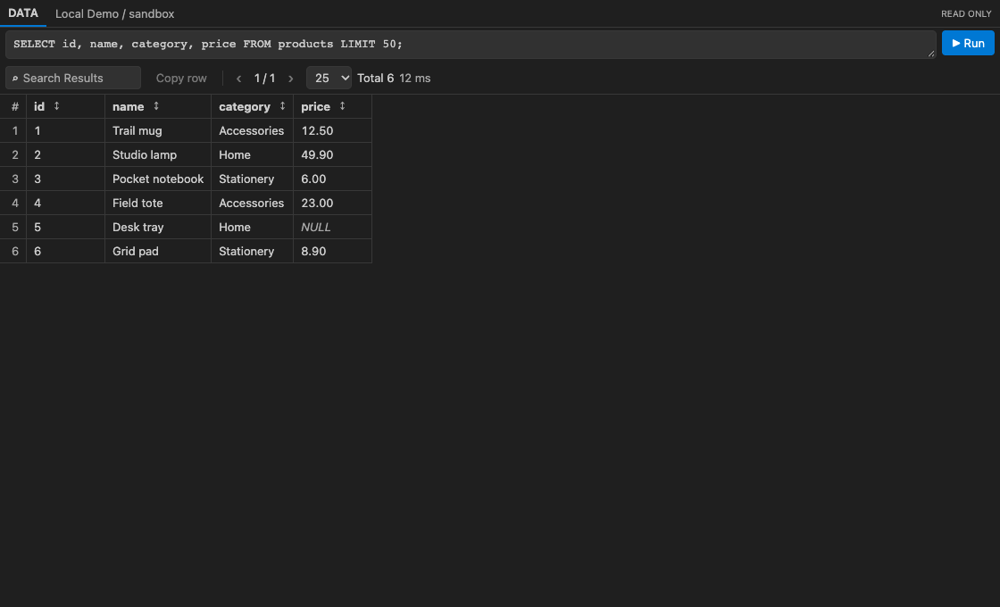

# SQLQuay

原名 Database Workbench。独立实现的 VS Code 只读 SQL 工作台。JDBC 与 DMS 使用同一套连接表单、数据库对象树、绑定 SQL 编辑器和多结果面板与会话内查询历史。

## 界面语言

自动跟随 VS Code 的显示语言：中文界面使用简体中文，英文界面使用英文，其他语言暂用英文。无需单独配置；更改 VS Code 显示语言并重载窗口后生效。连接表单、设置说明、命令菜单、DDL 悬停、结果页和提示同步切换，已有连接名称、SQL 和查询数据保持原样。下文用中文说明，并保留部分英文控件名便于对照。

## 当前发行范围

离线 Demo 可直接使用。在线连接当前支持 macOS / Linux，随扩展附带 MIT 许可的只读策略，无需下载私人脚本。JDBC 需要 Java 8+、Python 3.10+ 和可信 JDBC 驱动；DMS 需要 Python 3.10+、已配置的阿里云 CLI 及现有 DMS 插件。Windows 当前可用离线 Demo，在线通道暂未支持。

正式发行 ID 为 **TomMajor.sqlquay**，保留 `dbWorkbench.*` 设置和 `dbw.*` 命令。旧版 `local-workbench.database-workbench` 的连接、凭据和工作区绑定可通过本机迁移助手导入；凭据不写导出文件，旧数据保留。[旧版迁移步骤](docs/MIGRATION.md)

[版本记录](CHANGELOG.md) · [GitHub 维护与 Marketplace 上架](docs/PUBLISHING.md)

## 先用离线 Demo 跑通

1. 在 VS Code 的扩展视图选择 **Install from VSIX…**，打开 `artifacts/sqlquay-0.6.1.vsix`。
2. 打开活动栏 **SQLQuay** → **Local Demo**，点击右侧 **New Query**。
3. 按 `Cmd/Ctrl+Enter`，或点击 SQL 编辑器右上的 ▶。每次运行在旁边打开独立的 **Query Result #编号**，不会覆盖原结果。结果页改 SQL 后重新运行也会新开结果。
4. 对象树的 **sandbox → Tables → products** 可查看字段。Demo 是进程内固定数据，只识别 `SELECT 1 AS probe` 及从 `products` 读取显式列的简单查询（可加 `WHERE id = …` 和 `LIMIT`）；不联网、不访问真实数据库。

## 用 JDBC 读你自己的数据库

在 VS Code 用户设置中把 `dbWorkbench.driverJar` 设为可信的 MySQL Connector/J 8.0.12 或更新版 JAR 的绝对路径。需要 Java 8+、Python 3.10+，默认使用扩展附带的 `policy/query_guard.py`；需要时用 `dbWorkbench.javaPath`、`dbWorkbench.pythonPath` 指定解释器。`dbWorkbench.guardPath` 留空使用附带策略，或显式指向组织批准的同名脚本。JDBC 不调用 DMS CLI。

在 **Database** 标题右侧点 **+**，选择 **JDBC**，再选择 MySQL 或 Apache Doris / SelectDB，填写主机、端口、精确库名和只读账号。**Save** 只保存，**Connect** 先读取当前库的表清单、成功后保存。密码只由 VS Code SecretStorage 保存，不进入连接清单或命令参数。JDBC 默认使用 **TLS → Verify server identity**，加密并校验服务器证书与主机名。对于不提供 TLS 的端点，可以在单条连接里显式选 **Disabled (unencrypted)** 并确认。此模式不验证服务端身份，SQL 和结果不加密；公网生产优先用 DMS。原连接保留默认校验，查询失败不会自动切换 TLS 模式。切换或编辑连接后，原查询编辑器不会无提示改绑。

普通数据查询须使用有界谓词；MySQL 源表要有可核实的前导索引，扫描计划上限 10 万行；Doris / SelectDB 仅支持已识别的内部 OLAP 扫描，上限 1000 万行。

## 用 DMS 读已核实的库

### 默认：独立 AccessKey，不用配置 profile

1. 新建连接，选择 **DMS**。认证方式默认为 **AccessKey（推荐）**。
2. 点击 **获取 AccessKey…** 直达[当前 RAM 用户的 AccessKey 管理页](https://ram.console.aliyun.com/profile/access-keys)，自行登录有目标库查询权限的 RAM 用户并创建 AccessKey。不要使用主账号 AK。[官方创建说明](https://help.aliyun.com/zh/ram/user-guide/create-an-accesskey-pair)
3. 回到插件，粘贴 **AccessKey ID** 和 **AccessKey Secret**，确认 **地域**，在 **数据库** 一项输入完整或部分库名，点 **查找**。
4. 从同一输入框的下拉结果中选择目标库，无需重复填写库名或 Database ID；连接名称留空时也会自动填写。点 **保存** 只保存；点 **连接** 读取表清单后保存。

搜索只读取 DMS 库元数据，不执行 SQL。当前列出生产环境的 MySQL、Doris、SelectDB 及兼容实例；仅处理前 100 个匹配项，目标库缺失时输入更完整的库名。用户的 RAM/DMS 身份须有目标库查询权限；创建 AK 本身不授予库权限。

密钥只在本机表单、执行器内存和 VS Code SecretStorage 中处理，不写入设置、连接清单、命令参数、临时凭据文件或日志。搜索后输入框清空，本次表单在内存中保留凭据；保存前关闭表单即丢弃。编辑连接时不回显密钥，留空保留原凭据；更换 AK 后须重新搜索选库，相关文件随后须重新选择连接。

独立 AK 模式仍需要本机 Python 3.10+、阿里云 CLI 和已有 `aliyun-cli-dms-enterprise` 插件，但不要求先在 CLI 配置账号。它始终使用扩展附带的只读执行器：凭据仅在 CLI 子进程环境中生效，忽略本机既有 profile，每次操作使用独立临时目录保存非密 AI-Mode 状态，结束后关闭并移除该目录。不会读取或改写现有 AI/CLI 凭据配置、切换默认 profile 或自动安装插件。普通查询、DDL 悬停和显式点击的数据预览都使用所选连接的身份，保留 EXPLAIN、扫描阈值、全机单查询锁和超时不重试。

### 高级：保留已有 CLI profile

已有 profile 连接原样保留，不自动迁移。新建连接也可选择 **已有 CLI 认证配置（高级）**：选择本机 profile 和地域，填写精确库名及已核实的 Database ID。默认用库名查找；已有连接的自定义查找名称会保留在 **高级匹配设置** 中，仅在 DMS 需要用其他名称查找时填写。插件只通过 `aliyun configure list` 读取名称、区域和认证状态，不读取配置文件中的密钥。

没有 profile 时，可以点 **配置 CLI 认证…**，自行在终端完成认证，再刷新列表。插件只预填命令，不自动执行认证。旧版未保存认证选项的连接继续使用 `dms-prod` / `cn-hangzhou`；组织批准的 `dbWorkbench.dmsWrapperPath` 仅对 profile 方式生效。若要从 profile 改用独立 AK，请新建连接；现有 JDBC 和 DMS 不受影响。

## 直接执行已有 SQL 文件

打开本地 SQL 文件，点击状态栏的 **选择执行连接** 或编辑器右上的数据库图标，选择 JDBC 或 DMS。随后按 `Cmd/Ctrl+Enter` 执行选区或光标所在语句；未选连接时会先让你选择。选择连接本身不会执行 SQL。

执行连接按文件保存在工作区状态，重开该文件仍可使用；不改 SQL 内容。状态栏始终显示当前文件的连接、库和通道。已明确选择的执行连接也用于该文件的悬停和预览。原有单文件预览选择和工作区默认预览连接仍只负责预览，不会自动成为执行连接。

只改连接名称、分组或 DMS 搜索关键词，不会让原绑定失效。修改库、地址、端口、DMS Database ID、CLI profile/region、TLS 或认证后，仍须重新选择连接；不自动换库或重跑。

## 多结果、固定与会话历史

普通 SQL、表数据预览和 Properties 各自打开新结果页。结果工具栏点 **固定结果**，关闭面板后仍可从 **会话历史** 恢复；恢复只读取内存，不重新执行 SQL，也不会切换文件连接。侧栏标题的历史图标及命令 **会话查询历史** 都能打开列表。

固定、取消固定和同一结果的状态更新会保留输入框中尚未执行的 SQL 编辑；会话历史记录的仍是实际执行的 SQL。

每个扩展宿主会话最多保留 20 份结果。只淘汰已关闭、未固定的最旧记录；打开或固定的结果不被替换。若 20 份都打开或固定，先关闭或取消固定，再运行新查询。**清除已关闭且未固定的会话历史** 不影响打开或固定结果。SQL 和结果不写历史文件，重载窗口后会话历史清空。

## 表名搜索与元数据补全

侧栏搜索图标或 Tables 节点右键的 **搜索已加载的表** 会筛选内存中的表清单。选中后定位对象树，不发数据查询；尚未加载表清单时先用 **Load / Refresh Tables**。

SQL 的 FROM/JOIN 后可补全表名；输入表别名加点（例如 `p.`）可补全该表字段。补全采用当前文件的执行连接或预览连接，仅使用已加载的表清单、Properties 字段及悬停缓存中的 DDL，不在输入时查库。字段尚未缓存时，先悬停表名或查看 Properties。嵌入 SQL 块也使用同一补全。

函数括号内和相关子查询可解析可见的表别名；内层别名优先，内层 CTE 不会遮蔽外层物理表。别名与库名相同时先按别名补全字段。

## 常用文件中的嵌入 SQL

支持 Markdown 的 sql/mysql/pgsql 等 SQL 代码围栏、Python 三引号字符串、Java 文本块，以及 JavaScript/TypeScript 的反引号模板字符串。把光标放在静态 SQL 块内，用编辑器的 **Run SQL** 或右键运行；悬停表名即可预览 DDL，并可点击 **预览数据**。每份文件独立选择连接。

不运行 Python/Java/JavaScript，不解析 f-string 或模板插值，也不解码宿主转义。动态字符串、含反斜杠转义或未闭合代码块不自动识别。其他文本格式可手动选中纯 SQL 后用右键或命令运行；模板参数必须先明确化。非 SQL 文件不接管 `Cmd/Ctrl+Enter`，保留原语言快捷键。

JS/TS 正则字面量中的反引号文字不会被当作 SQL 模板；普通除法表达式不影响后续静态 SQL 模板的识别。

## 悬停查看表定义

打开已有的本地 `.sql` 文件，把鼠标停在表名上，DDL 会自动显示。只有还没选预览连接时才会提示 **选择预览连接**。从 **New Query** 打开的编辑器直接使用已有连接。支持常见 `FROM`、`JOIN`、`INSERT INTO/OVERWRITE` 和 `CREATE TABLE` 中的表名。

在 **SQLQuay → Database** 列表顶部点击 **DDL 默认预览连接**，给工作区内未单独设置的 SQL 文件指定默认连接。显式执行连接优先，其次是文件单独预览设置，最后是工作区默认。可用 **选择表定义预览连接** 更换或清除单文件预览设置；这些预览设置不改变 **Run SQL** 的绑定。

首次停在未缓存的表名上时，Workbench 用当前预览连接执行只读 `SHOW CREATE TABLE`，不读数据行。扫过表名、已有缓存或另一条在线请求正在执行时，不再发起查询。同一张表的并发悬停共享请求。**Load / Refresh Tables** 会清除对应连接的缓存，包括加载失败的记录。视图和包含外部引擎或疑似凭据的定义不显示。

点悬停卡片里的 **预览数据**，直接在 **Query Result** 看最多 100 行。不需要选字段；Workbench 只读取当前连接下单张物理表的显式非敏感列，不添加筛选或排序。JDBC 和 DMS 都先对不含 LIMIT 的扫描做 EXPLAIN，使用相同的扫描阈值和全机查询锁；估算不明或超限时拒绝预览，超时不重试。DMS 的专用预览入口复用已批准执行器的目标核对和 AI Mode 清理，普通 SQL 仍走原预检。

## 两种连接的运行行为

连接方式在新建时选择，已有连接仍使用原方式；若要换方式，为同一目标另建连接。编辑器和结果页的重跑使用绑定连接，不会因为切换侧栏或查询失败而改走另一通道。两种方式均使用本机共享查询锁，超时不重试。DMS 超时或清理失败、以及任一方式服务端状态未知时，Workbench 暂停两个在线通道；先核对服务端终态（DMS 还需核对 AI Mode 已关闭），再用 **Confirm Online Query Ended and Unlock** 解锁。

结果只保存在会话内存，普通查询最多展示已返回的 200 行，表预览最多 100 行。行数显示“已加载”，不充当表总数；筛选、排序、复制和翻页只操作已加载行。数值列按精确值排序，不把长整数或 Decimal 转为浮点数；NULL 升序在前、降序在后。DMS 不提供列类型时，仅在该列全部非空值都是数字格式时按数值排序。

## 分阶段耗时与连接复用取舍

JDBC 与 DMS 返回本次测量的连接、预检、执行耗时；结果页另列总耗时及其他开销。连接阶段包含桥接启动或 DMS 认证与目标解析；预检包含结构验证和 EXPLAIN。其他开销包含本地处理、传输和清理。未得到完整阶段指标时不展示分阶段数值，避免把未知耗时显示成 0。Demo 不显示数据库阶段耗时。

本版保留一次用户操作一个受控生命周期。DMS 必须在操作后关闭 AI Mode，不跨操作保持认证会话；JDBC 长驻桥接需要处理断线、连接配置变更和超时隔离。先用新指标观察真实操作，再决定是否引入长驻桥接；不通过删除预检或复用过去的 EXPLAIN 来降低耗时。

## 开发

开发需要 Node.js 22+、JDK 8+、Python 3.10+。先运行 `npm ci --ignore-scripts`，再用 `npm test`、`npm run test:jdbc` 和 `npm run test:dms` 验证。`npm run package` 先编译 Java 8 桥接类，再通过官方 `@vscode/vsce` 生成 VSIX；`npm run package:migration` 生成仅供旧用户本机使用的迁移助手。VSIX 不内置 Connector/J。历史实现记录见 [第一阶段](docs/PHASE_1.md) 和 [第二阶段](docs/PHASE_2.md)。

GitHub CI 安装锁定的开发依赖，检查公开内容、运行单测和两种通道的离线夹具，再构建 VSIX。夹具使用随仓库分发的策略、合成驱动与假 CLI，不访问真实数据库或本机账号。

## 仓库中的数据

测试及截图只用合成数据。数据库连接和密码由本机 VS Code 保存，结果及历史只存会话内存；这些内容不提交仓库。请勿把真实账号、连接地址、业务 SQL、日志或含真实数据的截图放进 Issue 或提交。

`npm run check:public` 检查跟踪文件中的私人主目录、内部地址、令牌及硬编码密码等常见泄漏。截图仍需人工检查。源码及附带策略使用 [MIT 许可](LICENSE)；外部运行依赖见 [分发说明](THIRD_PARTY_NOTICES.md)。
