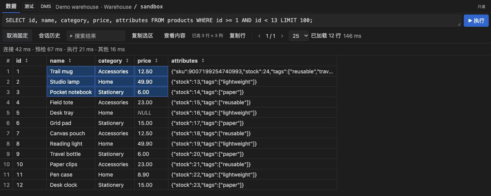
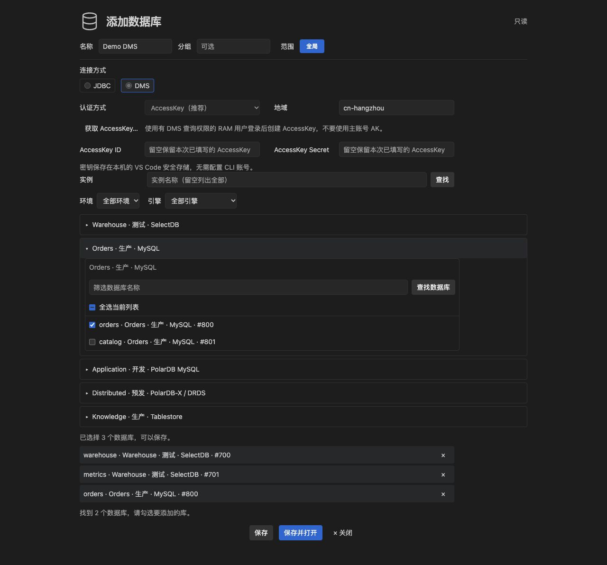
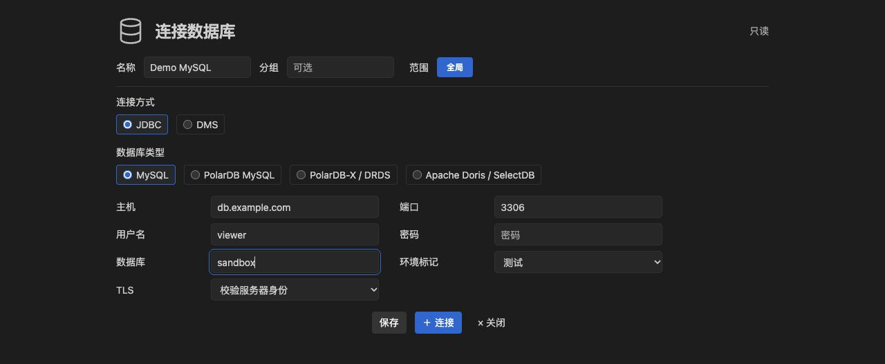
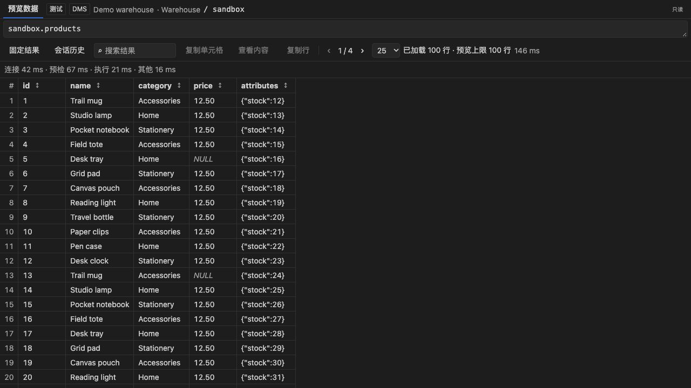
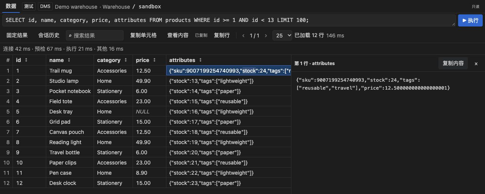
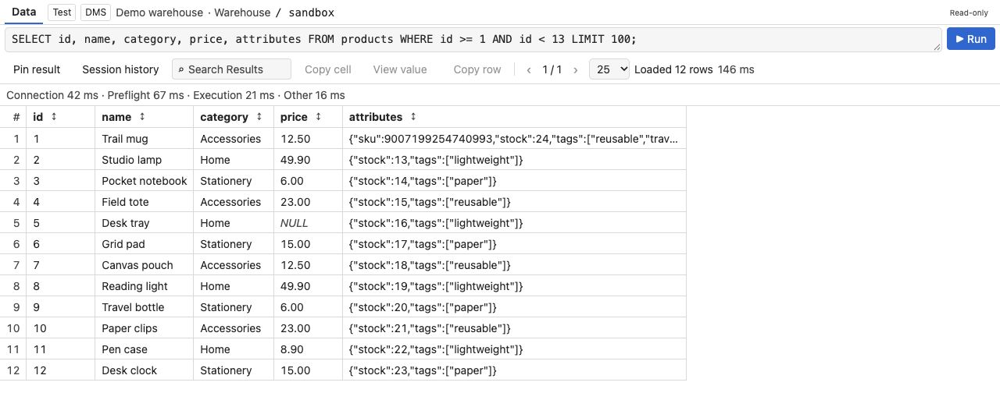

# SQLQuay

**在 VS Code 中连接数据库、编写只读 SQL、查看表定义和整理查询结果。**

JDBC 与阿里云 DMS 共用一套工作台。已有 SQL 文件可以直接绑定连接；查询、表预览和表属性各自保留结果，查看下一张表时也不用丢掉上一份查询。

[安装扩展](https://marketplace.visualstudio.com/items?itemName=TomMajor.sqlquay) · [下载 VSIX](https://github.com/POCO1010/sqlquay/releases) · [版本记录](CHANGELOG.md)



> 以下截图使用真实界面和合成示例数据，不包含真实账号、连接地址或业务数据。

## 一套 AccessKey，管理多个实例和数据库

DMS 按 **实例 → 数据库 → 表** 展开，支持环境和引擎筛选、分页、跨实例多选。可以继续追加数据库，也可以移除已添加的库；展开某个库时才加载它的表。

AccessKey 只保存一份，存入本机 VS Code SecretStorage。每个数据库有独立的目标身份、文件绑定和元数据缓存。



## JDBC 直连，连接选项清楚可见

选择数据库类型，填写主机、端口、库名和只读账号。默认启用 TLS 并校验服务器身份；需要使用不支持 TLS 的端点时，可在该连接中明确选择 Disabled 并确认。结果页会单独标出未加密状态。

JDBC 可以添加生产、测试、开发、预发等环境标记。未设置时显示“未标记”，不根据连接名称猜测环境。



## 在 SQL 文件中预览表定义和数据

打开已有 `.sql` 文件，选择执行连接后即可运行选区或光标所在语句。悬停表名自动显示 DDL；首次读取后使用缓存。可以为工作区设置默认预览连接，也可以给单个文件单独选择。

点击 **预览数据**，直接在新结果页查看最多 **100 行**，无需选择字段。查询前仍会核实目标、表结构和完整扫描预算。



## 复制一个值，也可以复制一块区域

点击单元格后按 `Cmd/Ctrl+C` 复制原值；按住 `Shift` 点击另一格，或使用 `Shift+方向键` 扩选，再复制矩形选区。多格按当前页的显示顺序输出 TSV，整行复制也保留。

双击长文本或 JSON，在只读详情中展开并复制完整内容。大整数和高精度小数保持原文。拖动列头边缘调整宽度，双击恢复；筛选、排序、翻页和复制都只操作已加载结果。



## 多结果、固定结果和会话历史

新 SQL、表预览和表属性分别打开结果页。固定结果后，即使关闭面板，也可以从会话历史恢复；恢复不会重新执行 SQL。每个扩展宿主会话最多保留 **20 份**结果，重载窗口后清空会话历史。

结果页显示连接、预检、执行及其他开销。运行中实时显示当前阶段；失败时区分认证、权限、分片、扫描估算不明和超限等原因，有可靠数字时同时展示估算与阈值。

## 中英文跟随 VS Code，深浅主题跟随编辑器

无需单独设置插件语言。中文 VS Code 使用简体中文，英文使用英文，其他语言暂用英文；连接名称、SQL 和数据内容保持原样。



## 支持哪些数据源

| 数据源 | 连接方式 | 当前能力 |
| --- | --- | --- |
| MySQL / RDS MySQL / PolarDB MySQL | JDBC、DMS | 库表、DDL、受控只读查询与预览 |
| Apache Doris / SelectDB | JDBC、DMS | 库表、DDL、内部 OLAP 扫描的只读查询与预览 |
| PolarDB-X / DRDS | JDBC、DMS | 库表、DDL、经单分片和底层扫描预检的只读查询与预览 |
| Tablestore | DMS | 已有 SQL 映射表的库表、字段与 DDL；数据 SQL 和预览暂未开放 |

DMS 可选择生产、测试、开发、预发、SIT、UAT、压测与灰度环境。实际可见的实例、数据库和查询权限取决于当前 RAM/DMS 身份。

## 先用离线 Demo 跑通

1. 在扩展市场搜索 **SQLQuay**，确认发布者为 **TomMajor** 后安装；也可从 Releases 下载 `sqlquay-0.8.2.vsix`，使用 **Install from VSIX…** 安装。
2. 打开活动栏 **SQLQuay**，在 **Local Demo** 上点击 **新建查询**。
3. 按 `Cmd/Ctrl+Enter`，查看结果、排序、筛选、选区复制和会话历史。

Demo 使用固定的内存数据，不联网。它支持 `SELECT 1 AS probe`，以及从 `products` 读取 `id`、`name`、`category`、`price` 的简单查询，可加 `WHERE id = …` 和 `LIMIT`。

## 配置在线连接

在线通道支持 **macOS / Linux**；Windows 当前可使用离线 Demo。

| 方式 | 本机依赖 |
| --- | --- |
| JDBC | Java 8+、Python 3.10+、可信的 MySQL Connector/J 8.0.12 或更新版本 |
| DMS | Python 3.10+、阿里云 CLI、已安装的 `aliyun-cli-dms-enterprise` 插件，以及目标库查询权限 |

### 用 JDBC 读你自己的数据库

把 `dbWorkbench.driverJar` 设置为 Connector/J JAR 的绝对路径。需要时通过 `dbWorkbench.javaPath`、`dbWorkbench.pythonPath` 指定 Java 和 Python。新建连接时选择 JDBC，填写目标库和只读账号；**保存**只保存配置，**连接**会先读取表清单。

插件不内置驱动 JAR。`dbWorkbench.guardPath` 留空使用随包的只读策略，也可以指向组织批准的 `query_guard.py`。

### 用 DMS 读已核实的库

1. 新建连接，选择 **DMS → AccessKey**。
2. 点击 **获取 AccessKey…**，在 [RAM AccessKey 管理页](https://ram.console.aliyun.com/profile/access-keys) 登录有 DMS 查询权限的 RAM 用户并创建 AK，不使用主账号 AK。
3. 在插件内填写 AK、Secret 和地域，查找实例，展开后勾选需要的数据库。
4. 点击 **保存**或**保存并打开**；随后展开需要的数据库，再加载表清单。

密钥只存本机 VS Code SecretStorage，通过标准输入交给本地执行器，仅 CLI 子进程获得临时凭据环境。不读取或改写已有 AI/CLI 凭据配置，不切换默认 profile，不自动安装或更新 CLI 插件。

已有 CLI profile 的用户可选择 **已有 CLI 认证配置（高级）**，显式选择 profile、地域、环境和精确目标。`dbWorkbench.dmsWrapperPath` 可指定组织批准的 `execute_safe.py`；独立 AK 方式始终使用随包策略。

## 直接执行已有 SQL 文件

点击状态栏的 **选择执行连接**，或编辑器右上角的数据库图标，选择具体的 JDBC/DMS 数据库。之后按 `Cmd/Ctrl+Enter` 执行选区或当前语句。连接选择按文件保存在工作区状态，不改 SQL 内容。

执行连接也用于该文件的 DDL 悬停和数据预览。预览连接的优先级为：**文件执行连接 → 文件预览连接 → 工作区默认预览连接**。工作区默认预览连接只负责预览，不自动成为执行连接。

只修改名称、分组或 JDBC 环境标记，或者在同一 AK 下追加数据库，不影响原绑定。修改目标、认证、TLS 或地域后须重新选择连接；插件不会无提示切库或重跑。

## 表名搜索、字段补全与嵌入 SQL

可以搜索已加载的表，在 `FROM/JOIN` 后补全表名，在别名加点后补全字段。补全使用已加载的表清单和 DDL 缓存，不在输入时查库；字段未缓存时，先悬停表名或查看表属性。

除 SQL 文件外，也支持 Markdown SQL 围栏、Python 三引号字符串、Java 文本块、JavaScript/TypeScript 静态模板字符串。其他文本文件可手动选中纯 SQL 后执行。不运行宿主语言，不自动识别动态插值、未闭合代码块或含转义的字符串；非 SQL 文件保留原语言快捷键。

## 只读和查询安全

- 只允许受控的 `SELECT`、`WITH`、`SHOW`、`DESC`、`DESCRIBE`、`EXPLAIN`。普通数据查询要求显式字段和有界条件；源库还需核实前导索引。
- 每条数据 SQL 独立预检：MySQL/RDS/PolarDB/DRDS 上限 **100,000 行**，Doris/SelectDB 上限 **10,000,000 行**。估算未知或超限时拒绝执行，`LIMIT` 不作为扫描边界。
- 只有主动点击 **预览数据** 才允许单表无 WHERE 预览：使用显式非敏感列，先检查不含 LIMIT 的完整扫描，再最多返回 **100 行**。
- DRDS 还需通过 `EXPLAIN SHARDING` 单分片和 `EXPLAIN EXECUTE` 物理计划检查。Tablestore 缺少可验证的扫描预算时只开放元数据。
- JDBC、DMS 与受控 CLI 共用查询锁。DMS 从认证前到 AI Mode 清理结束都持锁；超时不重试。清理失败或服务端状态未知时，两个在线通道暂停，核对终态后再使用 **确认在线查询结束并解锁**。

普通结果最多展示已返回的 **200 行**，预览最多 **100 行**。“已加载行数”不是表总行数。打开或固定的结果不被覆盖；20 份都占用时，需要先关闭或取消固定。

## 隐私、开发与许可

插件不把查询 SQL 或结果另存为本地历史文件。密码和 AK 不写入工作区设置、连接清单、命令参数或日志。仓库示例和截图均使用合成数据；提交 Issue 时也请去掉真实账号、连接地址、业务 SQL 和数据。

开发使用 Node.js 22+、JDK 8+ 和 Python 3.10+：

```sh
npm ci --ignore-scripts
npm test
npm run test:jdbc
npm run test:dms
npm run check:public
npm run package
```

源码采用 [MIT](LICENSE) 许可。Java、Python、阿里云 CLI 与 Connector/J 为外部依赖，参见[分发说明](THIRD_PARTY_NOTICES.md)。
